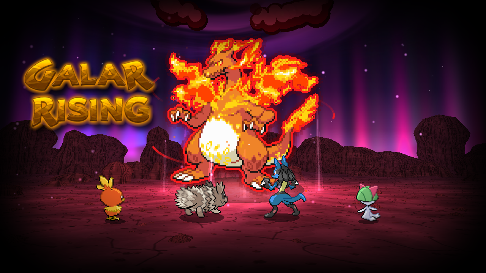
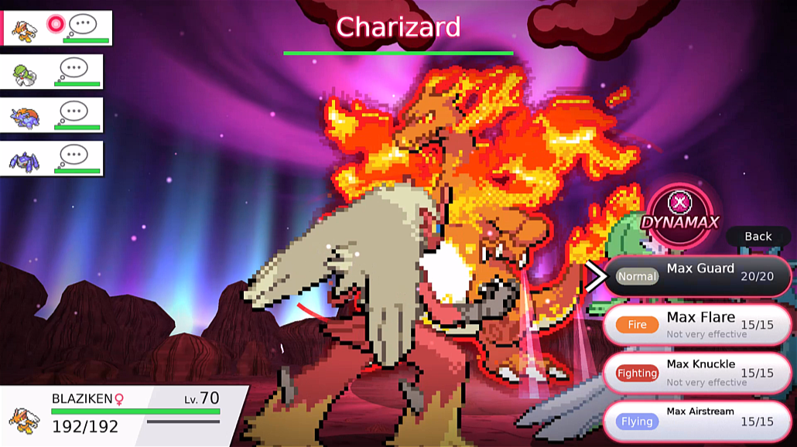
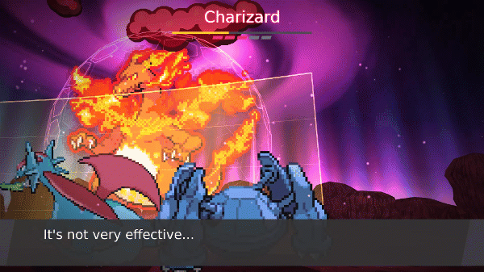
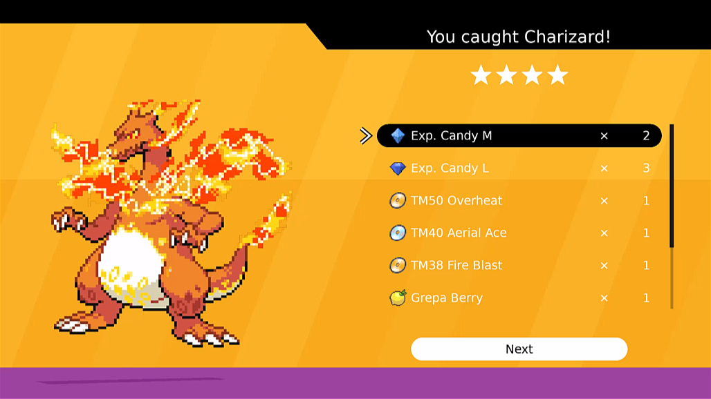

*Sword and Shield's Max Raid Battles in Ruby, Sapphire, Emerald, FireRed and LeafGreen.*

A mod for [Gen1Recomp](https://github.com/bryanthaboi/gen1recomp)'s Generation 3 games. After your
first Gym Badge, Pokémon Dens appear along the routes. Choose four of your Pokémon, battle a giant
Dynamax or Gigantamax Pokémon in 3D, then try to catch it.

> [!NOTE]
> **Requires [WoobleDex](https://github.com/poooooby/national_dex_gen3) 1.6.3 or newer and
> [WoobleSpritePack](https://github.com/poooooby/g9-battle-sprites-gen3).**

## 📸 Showcase

*A beam of light means a Pokémon is waiting in the den. Walk up and press A.*

*Pick your four and the giant bursts in.*

*Choose a move for each of your four, or Dynamax one of them.*

*Every move plays out on the battlefield.*

*Win, catch it and collect your rewards.*

## ✨ Features

- 🗺️ **Dens on every route:** one or two per route, each with a new raid every day. A den you've
  beaten rests until the next day. Days follow WoobleDex's Clock Source.
- 🔴 **Red and purple beams:** a red beam holds a Dynamaxed Pokémon from that route (from
  WoobleSpawns' tables when it's installed). A purple beam, about one den in ten, holds one of 37
  Gigantamax Pokémon.
- ⭐ **Star levels from 1★ to 5★** that rise with your Gym Badges, as in Sword and Shield.
- 🌌 **Sword and Shield's raid battle in 3D:** the battlefield, Max and G-Max Moves with their
  effects, barriers, and a camera that follows the fight.
- 🌦️ **Weather and terrain in the den:** Max Moves and moves like Rain Dance bring rain, harsh
  sunlight, sandstorms or hail over the den, and the terrains light up its ground, each with its
  effect on the battle.
- 💥 **Dynamax your own:** each of your four can Dynamax once per raid, and a Pokémon with the
  Gigantamax Factor Gigantamaxes.
- ⏳ **Ten turns, four faints:** win before either runs out. Your Pokémon fight as copies, so
  nothing in your party or boxes changes.
- 🎯 **One throw to catch it.** Higher stars give better IVs. A caught Pokémon has a Dynamax Level,
  and the Gigantamax Factor if it came from a Gigantamax raid. Shinies appear 1 time in 4,096.
- 🎁 **Rewards:** Exp. Candies, TMs, berries, treasures, Dynamax Candy, Max Mushrooms and more.
- 💎 **Dynamax Crystals** let you call a legendary or mythical Pokémon at any den.
- 🔴 **Dynamax in your own battles:** the dens' awakening gives you a Dynamax Band. In Gym Leader,
  Elite Four, Champion and rival battles (or wherever the DYNAMAX option says), one of your Pokémon
  can Dynamax once per battle for three turns. A short scene plays as it grows, always at normal speed even when the battle is sped up: your Pokémon returns to its ball, you raise the band,
  and the giant bursts out of a giant ball. Its moves become Max Moves, with their weather, terrain
  and stat changes. A Pokémon with the Gigantamax Factor Gigantamaxes and uses its G-Max Move. A
  Dynamaxed Pokémon glows red under a drifting Dynamax pattern.
- 🌦️ **Weather and terrain you can see:** in the game's own battles, rain, harsh sunlight, a
  sandstorm or hail stays on screen while it lasts, and a terrain lights the ground under each
  Pokémon. When a Max Move brings the weather, the game's own weather animation plays at once.
- 📟 **Kanto Gear's GEAR battle view:** while you choose a Dynamax move, a Max Move pad takes the
  Gear's screen (its second screen, its half of the window, or the whole screen, as its Display Mode
  is set), then hands it back.
- 🖥️ **OmniUI:** with its modern battle screen, the DYNAMAX button sits in its move details, its move
  cards show the Max Moves with their power, and a Dynamaxed Pokémon's card is framed red. The den's
  PC works on its storage screen.
- 👑 **Leaders Dynamax too:** once you have the band, Gym Leaders, the Elite Four, the Champion and
  rivals Dynamax their last Pokémon, Gigantamaxing it when it has a Gigantamax form.
- 🎮 **One screen or two:** the battle menu can go on a second screen, following Kanto Gear's Display
  Mode.
- 🎵 **Original raid music** for dens, battles and catches.
- 🏆 **14 achievements** when Recomp Achievements is installed.
- 🧩 **Other mods can add their own raids:** see [the Raid API](docs/RAID_API.md).

## ⚙️ Options

| Option | What it does |
|---|---|
| KANTO GEAR | ON (default): the battle menu follows Kanto Gear's Display Mode. OFF: BATTLE PAD decides. |
| BATTLE PAD | Only shown when KANTO GEAR is off. Puts the battle menu on the MAIN SCREEN or the SECOND SCREEN. |
| RAID DIFFICULTY | SOLO (default): tougher bosses, since all four Pokémon are yours, and every catch succeeds. SWORD / SHIELD: the games' own numbers. |
| MOVE INFO | How effective each move is against the boss: BASIC (default) shows words, FULL shows multipliers, OFF shows nothing. |
| RAID DENS | Turn dens on the routes on or off. |
| DYNAMAX | Where your Pokémon can Dynamax in the game's own battles: GYMS & LEAGUE (default: Gym Leaders, the Elite Four, the Champion and rivals), POWER SPOTS (those, plus any battle on a route with an active den), ALL TRAINERS, ALL BATTLES (wild ones too), or OFF. Leaders and the League's trainers Dynamax their last Pokémon wherever you can. |
| PERF.OVERLAY | Shows frame times in a den, for reporting slowdowns. |
| LANGUAGE | English (default), Japanese, Portuguese, Spanish, German, or CUSTOM (your own translation file). |

## 🎮 Controls

- **A** picks, **B** goes back, and the **D-pad** moves the cursor.
- **START** on the den screen starts the raid.
- **SELECT** or **R** on the move list presses DYNAMAX.
- In the game's own battles, **R** (or **START**) on the move list picks Dynamax. **A**, **B** or a
  tap skips the Dynamax scene.
- Every button can also be tapped.

## 📦 Install

1. Install [WoobleDex](https://github.com/poooooby/national_dex_gen3) and
   [WoobleSpritePack](https://github.com/poooooby/g9-battle-sprites-gen3).
2. Download `max_raids-X.Y.Z.zip` from the latest release and add it in Gen1Recomp's mod manager.
3. Turn on Galar Rising for a Gen 3 game.

## 👏 Credits

- **Raid bosses** (the 2.0 Giga Megas Pack): organized by Hazy Crazy / 4AllNighterGrinder64, with
  sprites and cries from Lucidious89's Dynamax DBK add-on. Battler sprites by the Smogon Sun/Moon and
  Sword/Shield Sprite Projects; animations by the "Sprites Animados" contributors with Lucidious89,
  Regis, Rod and kayzering; icons by Larry Turbo, Leparagon, Marin, MapleBranchWing and the DS
  Styled Gen 7+ Repository; shinies by StarrWolf and the Pokémon Shattered Light Team; compiled by
  Golisopod User, UberDunsparce and Caruban. The full list is in `assets/credits.txt`.
- **Raid music:** original music made for Galar Rising.
- **3D:** [g3d](https://github.com/groverburger/g3d) by groverburger (MIT).
- **Pixel art effects:** [pixelfx](https://github.com/patch-gg/pixelfx) by Patch, partly after Hugo
  Duprez's Sprite Fusion effects (MIT).
- **Type icons:** [PokéSprite](https://github.com/msikma/pokesprite) by msikma and contributors.
- **Dynamax Band, Dynamax icon and the giants' pattern:** from Lucidious89's [DBK] Dynamax plugin for Pokémon Essentials; the Dynamax scene follows its animation, with the sounds it plays (from Pokémon Essentials and the Deluxe Battle Kit).
- **Max Move power:** from Pokémon Showdown's data (MIT).

Pokémon and their designs are © Nintendo / Creatures Inc. / GAME FREAK Inc. This is an unofficial
fan project.
