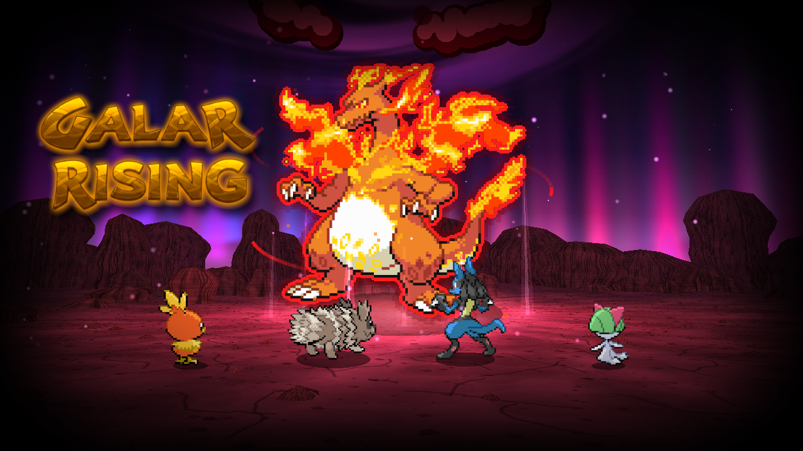
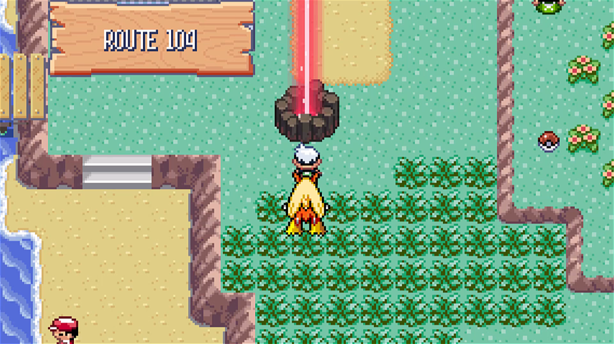
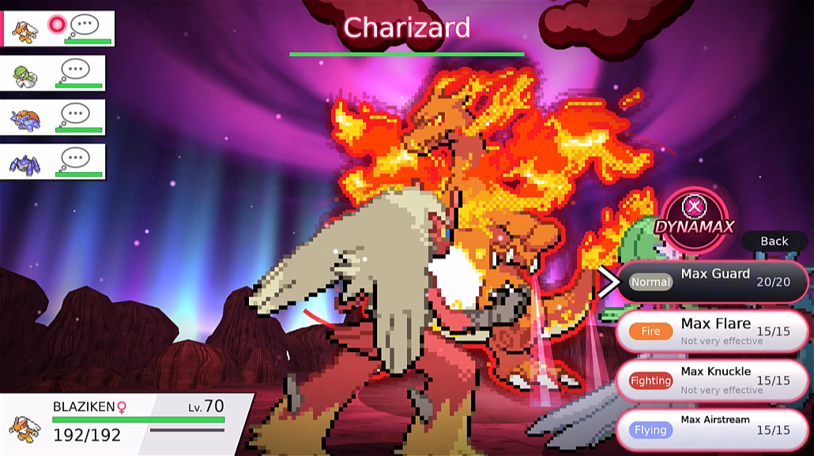
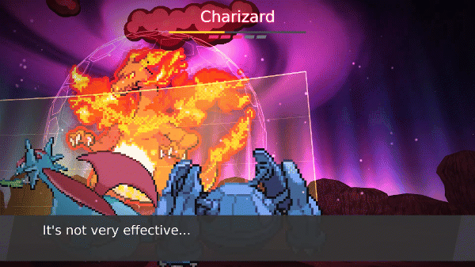
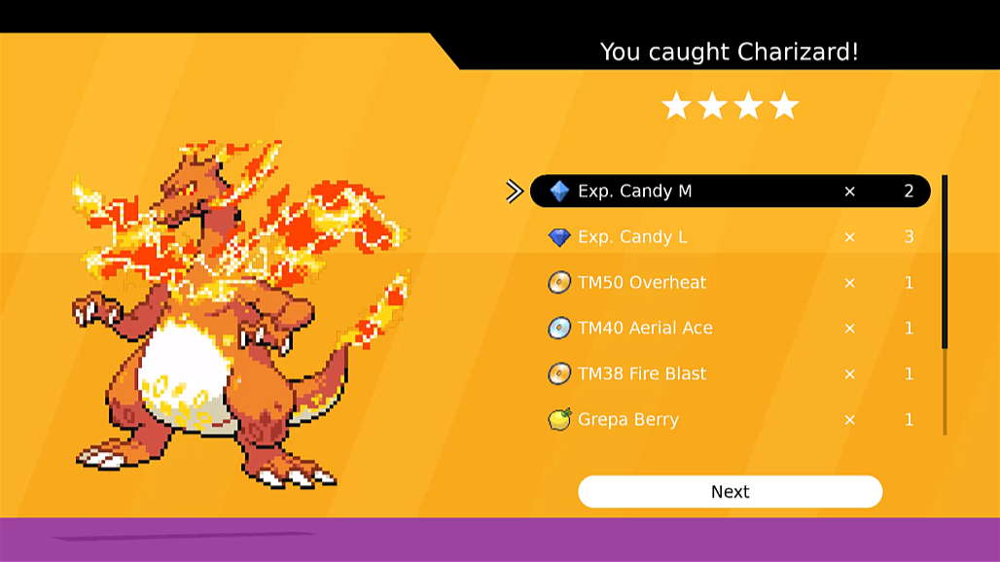

*Sword and Shield's Max Raid Battles in Ruby, Sapphire, Emerald, FireRed and LeafGreen.*

A mod for [Gen1Recomp](https://github.com/bryanthaboi/gen1recomp)'s Generation 3 games. Pokémon
Dens appear along the routes once you've earned your first Gym Badge. Step up to one, choose four
of your Pokémon, and take on a giant Dynamax or Gigantamax Pokémon on Sword and Shield's raid
battlefield in 3D, then try to catch it.

> [!NOTE]
> **Requires [National Dex Gen 3](https://github.com/poooooby/national_dex_gen3) 1.4.0 or newer**
> (the raid bosses' and your Pokémon's modern moves, the Fairy type, abilities, the Exp. Candies the
> raids reward, Dynamax Levels, the Gigantamax Factor and the Dynamax items) **and
> [G9 Battle Sprites (Gen 3)](https://github.com/poooooby/g9-battle-sprites-gen3)** (your Pokémon's
> animated sprites in the raid).

## 📸 Showcase

### 1. A pillar of light on the route

*After your first Gym Badge, dens appear along the routes. A beam of light means a Pokémon is waiting
inside: red for one of the route's own Pokémon, Dynamaxed, and purple for a rare Gigantamax one.
Walk up and press A.*

### 2. Into the den

*Pick your four and press Start. The camera pulls back from your team to the giant towering over
them, and it bursts in with a roar under the night sky, the aurora and the Dynamax vortex.*

### 3. Choose your moves

*Each of your four picks a move, an item or Run. The order runs down the left, the one choosing is at
the bottom, and its moves show their type and how they'll do. Press **DYNAMAX** and its moves become
Max Moves for three turns.*

### 4. Every move acted out

*Moves play out across the battlefield: beams, waves of water and fire, falling rocks and bites.
G-Max Moves leave lasting effects, like Wildfire's sea of flames burning your team each turn, and the
camera follows every hit.*

### 5. Catch it and claim your rewards

*Win, and you get one throw to catch it. Then the rewards card shows what you caught and everything
you won: Exp. Candies, TMs, berries and more.*

## ✨ Features

### Pokémon Dens

- ⚡ **The region awakens:** win your first Gym Badge and, when you step back outside, the
  ground shakes and pillars of light rise from Pokémon Dens along the routes.
- 🗺️ **Dens on the routes:** one or two on each route, always in the same places on your save.
  A den with a Pokémon in it shines a beam into the sky.
- 🔴 **Red beams:** a Pokémon of that route, Dynamaxed: any Pokémon you could meet there in the
  grass, on the water, fishing or with Rock Smash. With **Modern Spawns**, it's the route's
  Pokémon as Modern Spawns has them, every one a slot can roll. The more stars, the more
  evolved: as you'd find it at 1★ and 2★, one evolution on at 3★, fully evolved at 4★ and 5★.
- 🟣 **Purple beams:** the rare beam, about one den in ten: a Gigantamax Pokémon.
- 📅 **A new raid every day:** each den holds a new Pokémon each day, or sits quiet. A den you've
  beaten goes quiet until tomorrow. The day turns over at midnight by the same clock as National
  Dex Gen 3's **Clock Source**: your device's time when it's set to Device, the in-game clock on
  Ruby, Sapphire and Emerald when it's set to In-game.
- ⭐ **Harder raids as you go:** the stars follow your Gym Badges as in Sword and Shield: 1★–2★
  with one or two, 1★–3★ with three, 2★–3★ with four, 3★–4★ with five or six, and 3★–5★
  with seven or eight.

### The Den Screen

- 🔍 **What's waiting:** the den's stars, its Pokémon's types and its silhouette.
- 👥 **Your four:** your first four Pokémon are ready to go. Choose a slot to swap in another
  from your **party** or straight from your **PC boxes** (check a Pokémon's summary before you
  pick it). Boxed Pokémon stay in their box.
- ▶️ **Start** fades into the den; **Exit** leaves.

### The Raid

- 🌌 **Sword and Shield's battlefield, in 3D:** a barren plain of red dust, rounded crags and
  boulders round its sides, a night sky full of stars, and an aurora of violet, pink, blue and green
  shifting and dancing all round. The giant towers over your four in its red Dynamax aura, pink
  energy flickering up round its feet, its three dark-red clouds circling over its head and a vast
  violet vortex turning in the sky above it. A Dynamax Pokémon's cry is its own, deeper and slower.
  It bursts in with a roar, and the camera follows the fight: over your Pokémon's shoulder as you
  choose, pulled back as the giant attacks, and onto each of your Pokémon as an effect lands on them.
- 🐉 **37 Gigantamax Pokémon:** Charizard, Pikachu, Eevee, Snorlax, Gengar, Lapras and more,
  fully animated, with their cries.
- 🌿 **Dynamax Pokémon:** the route's own, with their own sprites and cries, and the moves a wild
  one of their level knows.
- ⚔️ **Fight, Bag, Run:** each of your four picks a move, or uses an item from the raid's pouch
  (Potions, a Full Heal and a Revive shared by the team). **Run** asks first: leave, and you're
  blown out of the den, which is spent for the day.
- 💥 **G-Max and Max Moves:** as in Sword and Shield, a Max or G-Max Move strikes one of your
  Pokémon, and its effect reaches whoever the game says it does. Volt Crash paralyzes all four,
  Smite and Gold Rush confuse all four, Cuddle makes those of the other gender fall in love (half
  their turns lost while the boss stands), Meltdown torments all four (no move twice in a row),
  Gravitas brings down Gravity for five turns (moves land more often, Ground moves reach Flying
  types and Levitate, Fly and the jumping moves fail), Wildfire leaves a sea of fire burning your team each turn,
  Snooze makes only the one it hit drowsy, and Depletion drains the PP of that Pokémon's last move.
  A Dynamax boss uses a Max Move of its strongest attack's type. A confused Pokémon may hurt itself
  instead of attacking, until the confusion wears off.
- 🌊 **Attacks on the whole party:** the boss's own spread attacks, such as Dazzling Gleam, Rock
  Slide, Heat Wave, Earthquake or Surf, hit all four of your Pokémon, each for three quarters of the
  damage, as in Sword and Shield. Every attack has its own look: beams, waves, falling rocks, bites,
  slashes, earthquakes that crack the ground.
- 🛡️ **Barriers:** as its HP falls, the boss throws up a barrier that blocks most of each hit
  until enough blows break it. Breaking it sharply lowers the boss's Defense and Sp. Def.
- 📣 **Cheers:** a Pokémon that fainted cheers the team on from the sidelines: healing, raised
  stats, or breaking the barrier.
- ⏳ **Ten turns, four faints:** the raid is lost if your Pokémon faint four times or the battle
  runs past ten turns. A fainted Pokémon is back at full health the turn after next.
- 🔴 **Dynamax your own:** any of your four can Dynamax while none of the others is giant, shown
  by a glowing ring beside each one that can. Press **DYNAMAX** on its move list: it grows giant for three turns, its HP
  raised by its Dynamax Level (×1.5 up to ×2), and its moves become Max Moves (status moves become
  Max Guard). A Pokémon with the Gigantamax Factor and a Gigantamax form Gigantamaxes: it takes
  its Gigantamax form (fully animated, from the pack) and uses its G-Max Move. The factor comes
  from catching it in a Gigantamax raid, or from a Max Soup (three Max Mushrooms; Urshifu also
  needs a Max Honey). Each of your four can Dynamax once a raid, one at a time. Zacian, Zamazenta and
  Eternatus can't.
- 🧱 **Max Moves as the games have them:** their power from the move they come from, Max Guard
  blocking every attack but G-Max One Blow and Rapid Flow, the team's Max Airstream, Knuckle, Ooze,
  Quake and Steelspike raising all four, and G-Max Moves landing on the boss (Wildfire's flames
  round it, Finale healing your team, Gold Rush's coins after the win). Low Kick, Grass Knot, Heat
  Crash and Heavy Slam fail on a Dynamax Pokémon; Behemoth Blade, Behemoth Bash and Dynamax Cannon
  hit it twice as hard.
- 🤝 **Moves for the team:** your four fight side by side, so the moves that help allies work as they
  do in Sword and Shield. Light Screen and Reflect raise a pane of glass in front of the whole team,
  Aurora Veil a shimmering one (it needs hail, which a den doesn't have). Safeguard, Mist and Tailwind
  cover all four. Wide Guard, Quick Guard, Crafty Shield and Mat Block guard the team for a turn, and
  Protect, Detect, King's Shield, Spiky Shield, Baneful Bunker, Obstruct and Endure guard the one using
  them. A Max Move still gets through a guard for a quarter of its damage. Follow Me and Rage Powder
  draw the boss's attacks. Helping Hand, Heal Pulse, Floral Healing, Pollen Puff, Decorate and
  Aromatic Mist ask which ally to use them on. Life Dew, Jungle Healing, Heal Bell, Aromatherapy, Wish,
  Howl, Coaching, Gear Up, Magnetic Flux and Flower Shield work on the team. A boss's own screens and
  Protect work against your team the same way.
- 🌊 **Friendly fire:** moves that hit everyone around the user in Sword and Shield (Surf,
  Earthquake, Discharge, Lava Plume, Bulldoze, Boomburst, Explosion and more) hit the boss and your
  other three too, never the user. Picking one shows your four with an arrow on each it will hit (the
  user marked Immune); a move for the whole team, such as Light Screen or Wide Guard, shows the arrow
  on all four. Wide Guard and Protect shield your team from an ally's Surf too, and Explosion faints
  its user.
- 🔒 **Your Pokémon are safe:** your four fight as copies. Nothing in your party or boxes changes
  in a raid, win or lose.

### After the Win

- 🔴 **One throw to catch it:** choose one of your Poké Balls. The Pokémon joins your party, or
  your PC when the party is full. The higher its stars, the harder it is to catch, and the better
  its IVs: one perfect IV at 1★, two at 2★, three at 3★, four at 4★ and 5★.
- ✨ **Shiny raid Pokémon:** a den's Pokémon is shiny 1 time in 4,096, as in Sword and Shield, and a
  Dynamax Crystal's legendary raid 1 in 300, as the Dynamax Adventures. A shiny one shows its shiny
  colours from the start and sparkles once its entrance clears; catch it and it's shiny in your party.
- 🌟 **Dynamax marks:** a caught raid Pokémon has a Dynamax Level by the raid's stars (1–2 at 1★
  up to 6–8 at 5★), and one caught from a Gigantamax raid has the Gigantamax Factor. Both show on
  its summary.
- 🎁 **Rewards:** Exp. Candies (more and bigger for more stars), a Dynamax Candy (two at 5★), TMs of
  the boss's types, berries, treasures to sell, sometimes a Rare Candy, now and then Max Mushrooms
  (from 3★), Max Honey (5★) or a Dynamax Crystal (4★–5★), and on the hardest raids a PP Max.
- 💎 **Dynamax Crystals:** at any den, quiet or not, a Dynamax Crystal in your bag lets you call a
  legendary or mythical Pokémon instead (a 5★ raid; the crystal is spent when you press Start, and the den itself
  is left as it was). Win, and it's caught for certain.

### Your Screen

- 🎮 **On one screen or two:** the battle menu sits over the den, or goes to your device's second
  screen (such as the AYN Thor's) as large touch buttons, leaving the whole den on the main screen.
- 📱 **Phones held upright:** on a portrait screen the den fills the width, the battle's buttons and
  words sit at the foot at a size made for it, and the den screen and rewards card sit in the middle.
- 🧭 **Follows Kanto Gear:** with **Kanto Gear**, the battle menu goes where its Display Mode
  says. Its Separate Screens setting puts the menu on the second screen.
- 🤝 **Shares the second screen with NaviPlay:** while the battle menu is on the second screen,
  NaviPlay (Super Training, Pokémon-Amie) steps aside, and comes back when the raid ends.
- 🎵 **Sword and Shield's raid music:** a red den plays the raid den themes, a purple Gigantamax
  den and a legendary raid the Dynamax Adventure ones: their adventure theme on the den screen, the
  battle theme in the raid (a legendary raid its own, Eternatus its own), the capture theme while you
  catch. Each loops seamlessly and follows the game's music volume.
- 🔊 **The game's own sounds:** moves, hits, barriers and the catch use Gen 3's sound effects.

## ⚙️ Options

| Option | What it does |
|---|---|
| KANTO GEAR | ON (default): the battle menu follows Kanto Gear's Display Mode (Separate Screens puts it on the second screen; without Kanto Gear, a second screen is used when there is one). OFF: BATTLE PAD decides. |
| BATTLE PAD | Shown with KANTO GEAR off. MAIN SCREEN: the battle menu over the den. SECOND SCREEN: the menu on your device's second display. |
| RAID DENS | ON (default): dens appear on the routes. OFF: none appear. |

## 🎮 Controls

- **A** picks, **B** goes back, the **D-pad** moves the cursor; **START** on the den screen starts
  the raid; **SELECT** or **R** on the move list presses DYNAMAX.
- Every button can be tapped on a touch screen, on the main screen or the second one.
- The second screen works by touch: a button presses in under your finger. Use the D-pad there
  and a highlight appears, moving between the buttons as they are laid out.

## 📦 Install

1. Install [National Dex Gen 3](https://github.com/poooooby/national_dex_gen3) and
   [G9 Battle Sprites (Gen 3)](https://github.com/poooooby/g9-battle-sprites-gen3) first.
2. Download `max_raids-X.Y.Z.zip` from the latest release and add it in Gen1Recomp's mod manager.
3. Turn on Galar Rising for a Gen 3 game.

## 👏 Credits

- **Raid bosses** (the 2.0 Giga Megas Pack): resource organization and formatting by Hazy Crazy /
  4AllNighterGrinder64; the animated sprites and cries from the Dynamax DBK add-on by Lucidious89
  (Deluxe Battle Kit). Battler sprites by all contributors to the Smogon Sun/Moon and Sword/Shield
  Sprite Projects; animations by the contributors to the "Sprites Animados" plugin (listed in full
  in `assets/credits.txt`) with Lucidious89, Regis, Rod and kayzering; icons by Larry Turbo and
  Leparagon (Gen 8), Marin, MapleBranchWing and the DS Styled Gen 7+ Repository (Gen 7), shinies
  by StarrWolf and the Pokémon Shattered Light Team, compiled by Golisopod User, UberDunsparce and
  Caruban.
- **Raid music:** from Lucidious89's [DBK] Raid Battles (Pokémon Essentials Deluxe Battle Kit),
  Pokémon Sword and Shield's raid themes.
- **3D:** [g3d](https://github.com/groverburger/g3d) by groverburger (MIT).
- **Type icons:** from [PokéSprite](https://github.com/msikma/pokesprite) by msikma and contributors.
- **Max Move power:** after Pokémon Showdown's data (MIT).

Pokémon and their designs are © Nintendo / Creatures Inc. / GAME FREAK Inc. This is an unofficial
fan project.
